# ClayScorer Pro — User Guide

ClayScorer Pro scores CPSA clay shooting rounds on your phone, tablet or computer. It covers four disciplines:

| Code | Discipline | Layout |
|---|---|---|
| **ESP** | English Sporting | You choose the number of stands (1–20) and pairs per stand (2–6), with an optional +1 single clay on any stand |
| **STR** | Sportrap | 5 rounds × 5 targets = 25 |
| **CSP** | Compak Sporting | 5 rounds × 5 targets = 25 |
| **ESK** | English Skeet | 7 stations, the standard CPSA sequence (H / L / H+L / L+H) plus the option target |

Screenshots are from an iPhone. Names and grounds in them are made up. For what the printed and shared scorecards look like for every discipline, see [example-outputs.pdf](example-outputs.pdf).

**Contents**

1. [Getting started](#1-getting-started)
2. [Setting up a round](#2-setting-up-a-round)
3. [Scoring](#3-scoring)
4. [Discipline notes](#4-discipline-notes)
5. [Describing clay presentations](#5-describing-clay-presentations)
6. [Leaderboard, notes and locking](#6-leaderboard-notes-and-locking)
7. [Round history](#7-round-history)
8. [Exporting and sharing](#8-exporting-and-sharing)
9. [Signing in and syncing](#9-signing-in-and-syncing)
10. [Your account and managing users](#10-your-account-and-managing-users)
11. [Tips and troubleshooting](#11-tips-and-troubleshooting)

---

## 1. Getting started

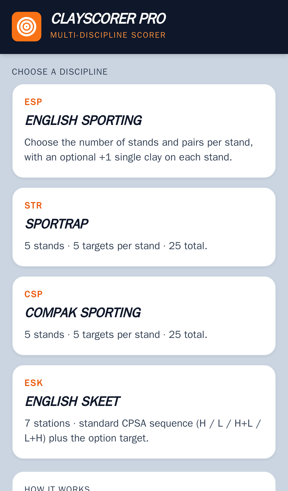

Open the app's web address and pick a discipline. Each discipline keeps its own rounds, so a Sporting round and a Skeet round never get mixed up.

If a discipline has a round in progress, its tile shows **Continue: …** with the ground or event and how many targets have been scored.

**Install it on your phone** so it opens full screen like an app:

- **iPhone / iPad (Safari):** tap **Share**, then **Add to Home Screen**.
- **Android (Chrome):** tap the **⋮** menu, then **Add to Home screen** or **Install app**.

**Zooming.** Double-tapping doesn't zoom the page, so quick repeated taps on the score buttons stay put. Use two fingers to pinch-zoom if you need a closer look.

**It works without signal.** Once the app has been opened while online, it keeps working offline. Scores are saved on the device as you tap, and an **Offline** tag appears in the header while there's no connection.

**The header**, on every discipline page:

| Button | What it does |
|---|---|
| Orange logo | Back to the discipline list. Each discipline has its own icon: a crossing clay (Sporting), a clay rising from a trap (Sportrap), a clay over five stands (Compak), high and low houses (Skeet) |
| **History** (box icon + count) | Saved rounds, Import CSV, New round — see [Round history](#7-round-history) |
| **Cloud** | Sign in and sync — see [Signing in and syncing](#9-signing-in-and-syncing) |
| **Export** (orange) | Show scorecard, Show PDF, Show presentation, Download CSV — see [Exporting and sharing](#8-exporting-and-sharing) |
| **Lock** | Lock the round so scores can't be changed |

The thin orange bar under the header shows how much of the round has been shot.

---

## 2. Setting up a round

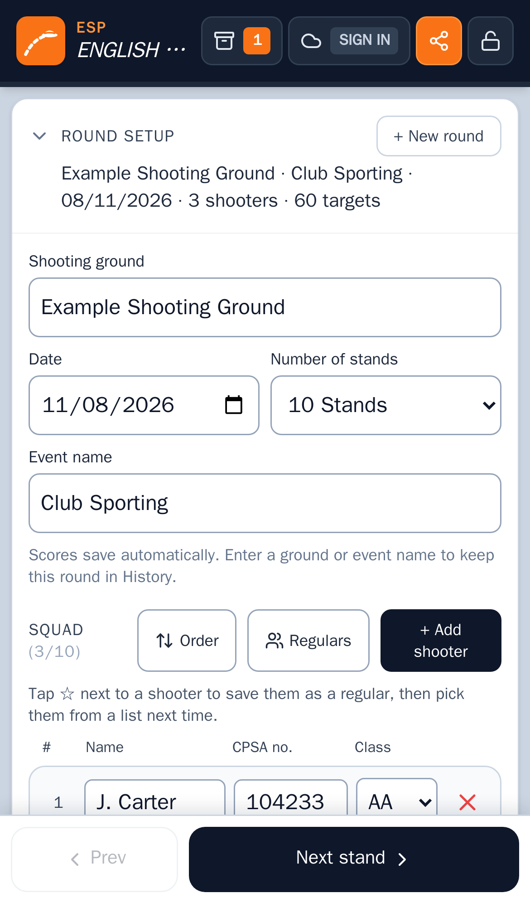

Open **Round setup** at the top of the page.

- **Shooting ground**, **Date** and **Event name.** Fill in a ground or an event name to keep the round in History. Rounds with neither are not saved to History.
- **Number of stands** (English Sporting only), from 1 to 20. Sportrap, Compak and Skeet show their fixed format instead.
- **Squad:** tap **+ Add shooter**, up to 10 shooters. Each has a **Name**, an optional **CPSA no.** and a **Class** (AAA, AA, A, B, C, U). Tap the red **×** to remove a shooter. If they have scores, you're asked to confirm first. A round always keeps at least one shooter.
- **Gun** and **Cartridges** (optional, under each shooter): shown on the [Presentation](#presentation) squad slide. There's no length limit on Cartridges, so you can describe a different load for each barrel. Leave them blank if you don't want them on the slides.
- **+ New round** starts a fresh round. The current one stays in History.

Everything saves automatically; there's no Save button.

**Shooting order.** Tap **Order** in the Squad header, then use the up and down arrows to move shooters. Number 1 shoots first. On English Sporting, **First up** then moves one place each stand. Scores stay with each shooter, so you can change the order at any time unless the round is locked. Tap **Done** to go back to editing names.

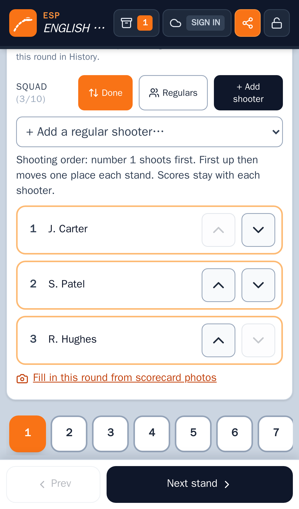

### Regular shooters

Save the people you shoot with regularly so you don't have to type their details every time.

- **Save a shooter:** tap the ☆ on their row in the squad. A filled gold star means they're saved. A half star means their details in this round differ from the saved ones; tap it to update the saved copy.
- **Add a regular to a round:** pick them from **+ Add a regular shooter…** above the squad. Their name, CPSA no., class, gun and cartridges are filled in. They take the place of an untouched placeholder shooter ("Shooter 1" with no details or scores) if there is one; otherwise they're added as a new shooter. Anyone already in the squad is greyed out in the list.
- **Turn an existing shooter into a regular:** tap the person-with-tick icon at the start of their second line and pick a regular. Their name, CPSA no., class, gun and cartridges change to the regular's, and **all their scores stay with them**. This is handy when someone was scored as "Shooter 2" or under a nickname.
- **Edit or delete regulars:** tap **Regulars**. Changes there don't alter rounds you've already set up. Regulars are listed alphabetically there and in the dropdown.
- **Shared across disciplines:** the same list appears on all four discipline pages. When you're signed in it's also saved to your account and appears on your other devices. If you edit the list on two devices before they sync, the most recent edit wins.

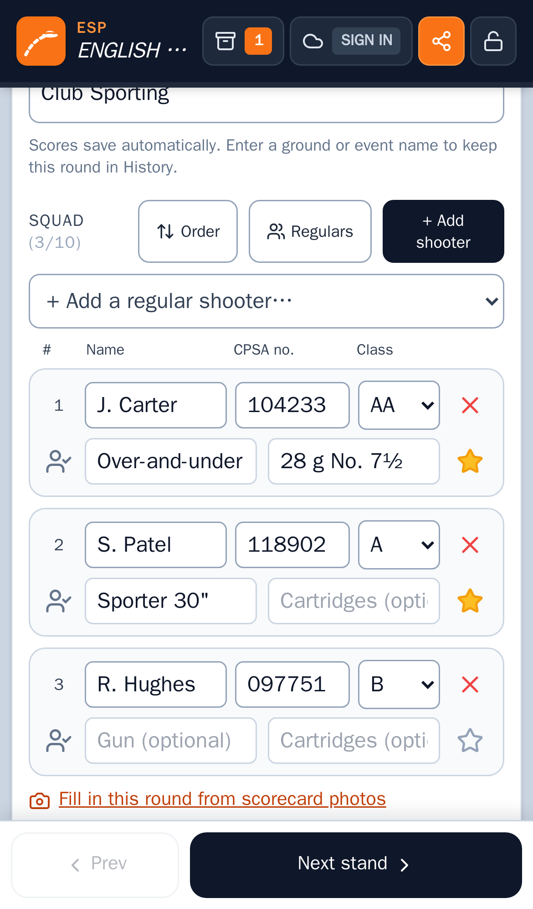

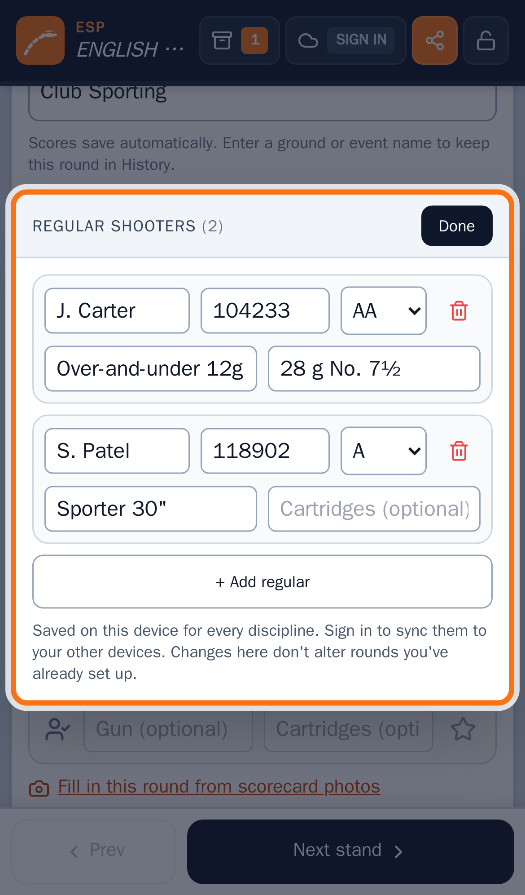

Once the first target is scored, Round setup folds away to give the scoring more room. Tap its heading to open it again. A one-line summary (ground, event, date, shooters, targets) stays visible.

---

## 3. Scoring

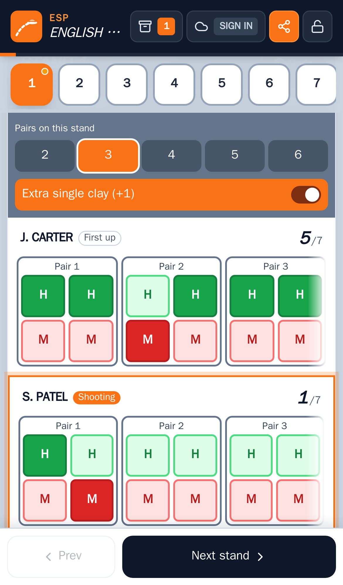

**Moving between stands.** The numbered buttons under the header take you to a stand: **R1–R5** for rounds on Sportrap and Compak, stations on Skeet. You can also use **Prev** and **Next** at the bottom. A small dot on a stand button shows its progress: amber while it's partly shot, green once the whole squad has finished it. A finished stand's button also turns light green.

**Recording a target.** Each shooter has a row of boxes, grouped as they are thrown: *Pair 1, Pair 2…* on Sporting, *Single / On report / Sim pair* on Sportrap and Compak.

- Tap **H** for a hit or **M** for a miss. The chosen button turns solid green or red.
- Tap the same button again to clear it back to "not shot".
- **Undo** (top right of the stand) reverses the last tap. It goes back one step only.

**Who's shooting.** An orange **Shooting** tag and outline mark the first shooter who hasn't finished the stand. On English Sporting the shooting order rotates each stand; the **First up** tag shows who leads, and they're listed first.

**Last pair alert.** When the shooter who's up has only one pair left on the stand, their tag turns red and reads **Last pair**. If what's left is a single target, such as a +1 extra clay or the Skeet option target, it reads **Last target**.

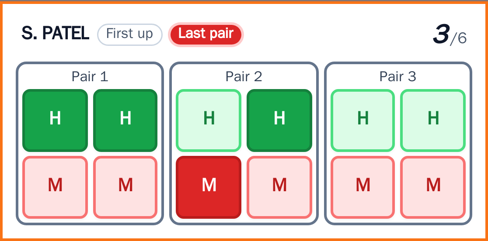

**Scrolling scores on phones.** On English Sporting and Compak, each shooter's row scrolls sideways on a phone, with about three pairs in view. A soft fade at the edge means there's more to see. The row remembers where you scrolled, opens on the shooter's next unshot pair when you change stand, and slides on to the next pair when you finish one. Sportrap and Skeet rows wrap onto a second line instead when they don't fit.

---

## 4. Discipline notes

### English Sporting (ESP)

On each stand, under **Pairs on this stand**, choose 2–6 pairs. Switch on **Extra single clay (+1)** if the stand has an extra single. The extra clay is scored on its own, shown with an orange dashed outline.

### Sportrap (STR) and Compak (CSP)

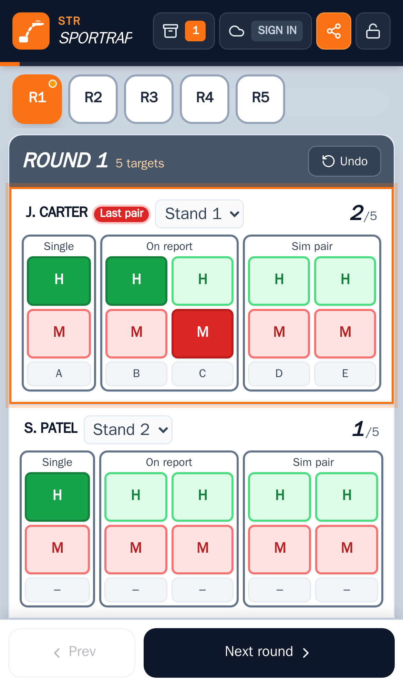

A **round** (R1–R5) is one pass of the squad. Each shooter starts each round on a physical **stand** (1–5); the stand picker next to each name sets this. By default shooters rotate one stand per round.

Under **Round setup › Stand setup** you set, for each physical stand, how its clays are thrown (**Single**, **On report** or **Sim pair**) and which presentation each clay is (A, B, C…). The scoring rows follow that layout, and each box shows its presentation letter.

The **Presentations** panel above the scoring card is where you describe each presentation (see [section 5](#5-describing-clay-presentations)). Compak has seven presentations (1/A–7/G) by default; **+ Presentation** adds another.

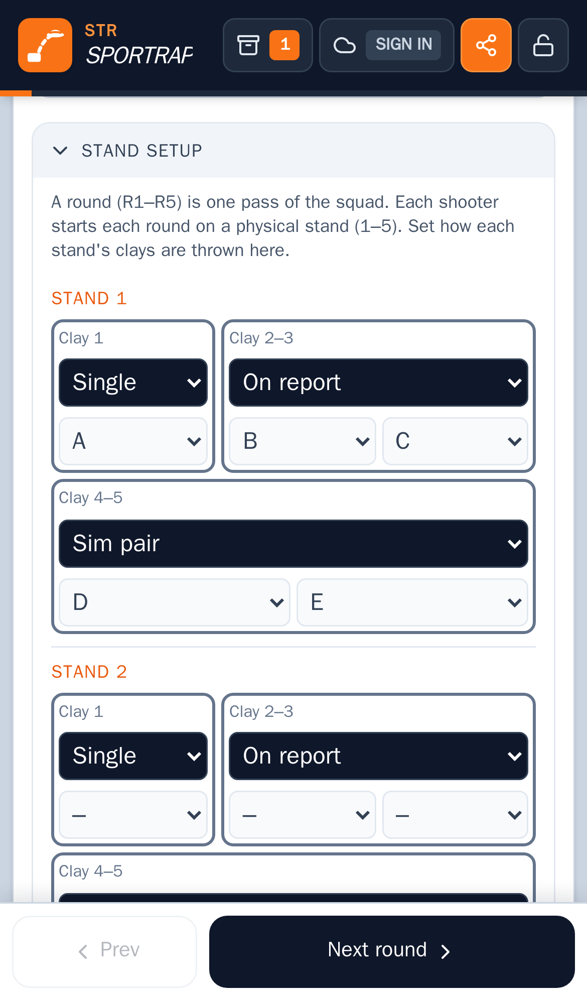
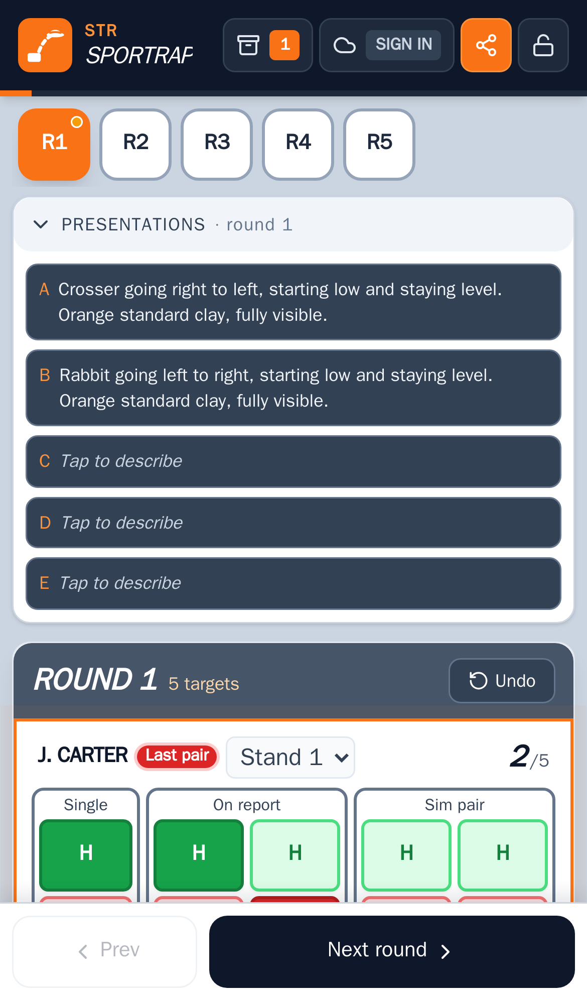

### English Skeet (ESK)

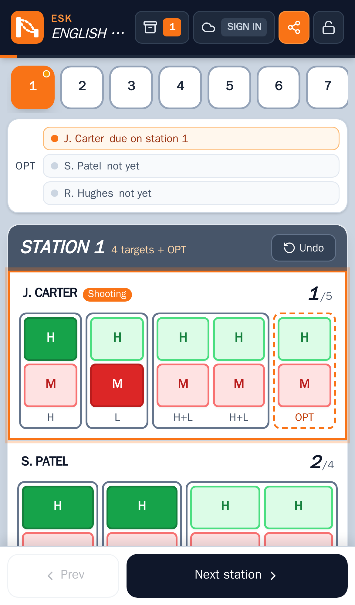

Each box is labelled with what is thrown: **H** high house, **L** low house, **H+L** / **L+H** a double, with the first-named bird thrown first.

**Option target (OPT).** The panel above the scoring card tracks each shooter's option target:

- **not yet:** no miss so far.
- **due on station N:** the shooter's first miss was on station N. Score the re-shoot there in the dashed **OPT** box.
- **used on station N:** already shot.

A shooter who is straight after 24 targets takes the option on station 7.

---

## 5. Describing clay presentations

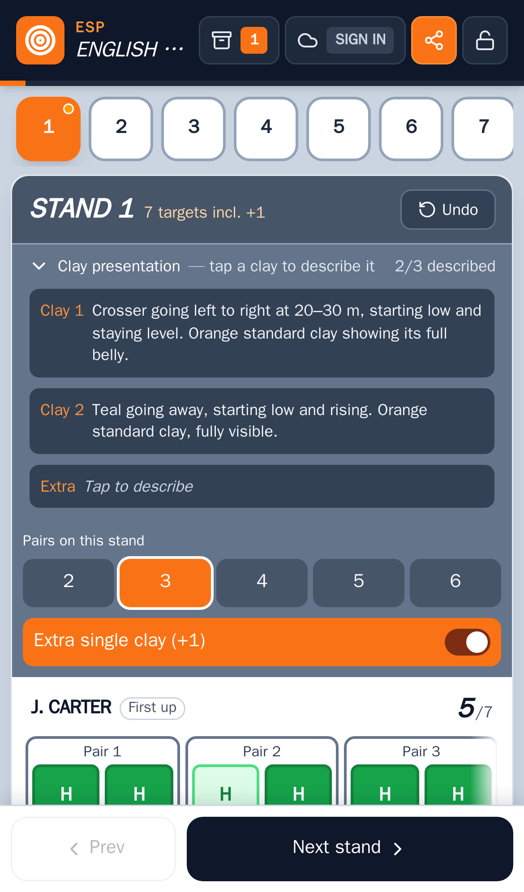

You can record how each clay is presented. It's optional, and it doesn't affect scores. The descriptions appear in the app and on a separate page of the printed and shared scorecards.

- **English Sporting:** the **Clay presentation** section sits in each stand's scoring card, with one button per clay (Clay 1, Clay 2, and Extra for a +1). The heading shows how many clays are described, e.g. *2/3 described*. Tap the heading to show or hide the section; each device remembers your choice.
- **Sportrap and Compak:** use the **Presentations** panel. It describes presentations A, B, C… for the current round.

Tap a clay to open its description window:

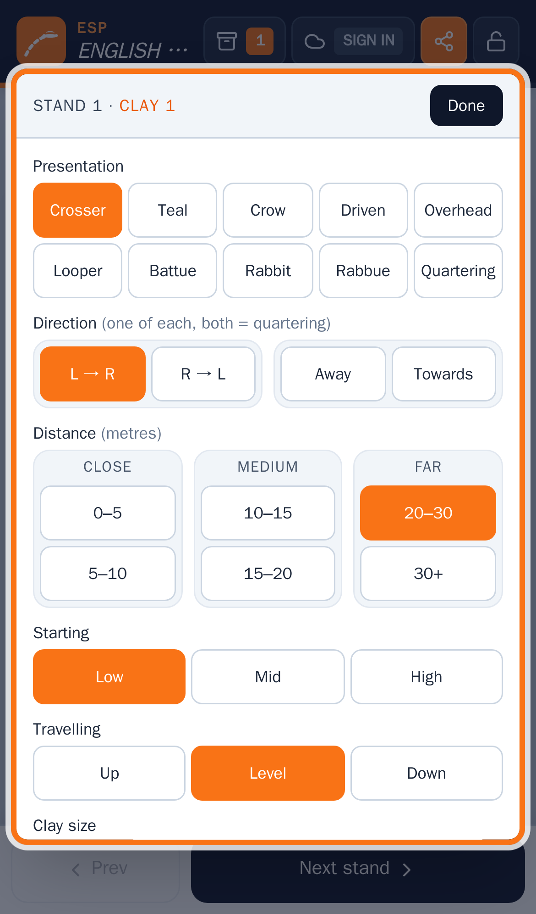

| Field | Options | Notes |
|---|---|---|
| Presentation | Crosser, Teal, Crow, Driven, Overhead, Looper, Battue, Rabbit, Rabbue, Quartering | |
| Direction | **L → R** or **R → L**, and **Away** or **Towards** | Pick up to one from each group. Picking one of each describes the clay as *quartering away* or *quartering towards* |
| Distance (metres) | Close: 0–5, 5–10 · Medium: 10–15, 15–20 · Far: 20–30, 30+ | |
| Starting | Low, Mid, High | Default **Low** |
| Travelling | Up, Level, Down | Default **Level** |
| Clay size | Std110, Midi90, Mini70 | Default **Std110** |
| Clay face | Edge, Belly, Top | Choosing **Edge** clears Clay face amount |
| Clay face amount | Full, Part | Default **Full** |
| Colour | Orange, Black, Pink, Green | Default **Orange** |

- **Defaults.** A clay you haven't described yet shows the defaults already selected. They're saved as soon as you change anything on that clay.
- **Clearing a choice.** Tap a selected option again to clear it.
- **Closing.** Tap **Done**, tap outside the window, or press Escape.

The description builds itself as you go and is shown at the bottom of the window and on the clay's button. For example:

> Crosser quartering away left to right at 20–30 m, starting low and rising. Orange standard clay showing its full belly.

---

## 6. Leaderboard, notes and locking

**Leaderboard.** Below the scoring card is a table with a row for each stand and a column for each shooter, plus totals.

- 🔥 next to a shooter's name means no misses so far.
- ❗ marks the hardest completed stand: the one the squad scored worst on, on average.
- The shaded row is the stand you're on.

**Round notes.** At the bottom of the page: a **Weather** section, then a free-text **Notes** box. Both are saved with the round and printed on the PDF.

**Weather.** Tap **+ Add weather** to record the conditions at a time of day. Add several entries if they changed, e.g. start and end of the round.

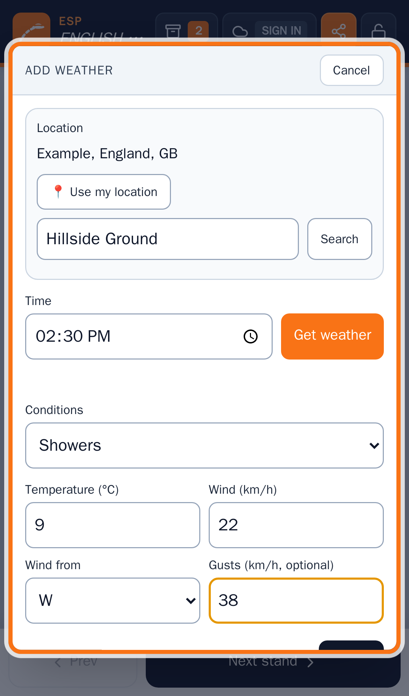

1. **Location** (only needed for *Get weather*):
   - **📍 Use my location** uses your phone's or computer's location. Your browser asks for permission the first time.
   - **Search** looks up a place by name. It starts with the ground's name; pick the right one from the list.
2. **Time.** It defaults to now for today's round.
3. **Get weather** fills in the conditions, temperature, wind speed, wind direction and gusts for that place and time, from [Open-Meteo](https://open-meteo.com). It works for today, recent and past rounds, and up to about two weeks ahead.
4. Check or change anything, or skip *Get weather* and fill the fields in yourself. Then tap **Save**.

Temperatures are in °C and wind in mph; *wind from* is the direction the wind blows from. Tap **Edit** on an entry to change or delete it.

**Each entry keeps its own location.** If every entry is from the same place, the place is shown once next to **Weather**. If they're from different places, each entry shows its own, e.g. *09:00 · My location · Sunny …* and *14:00 · Bisley, Surrey · Showers …*. A new entry starts with the last location you used, and editing an entry starts from that entry's location.

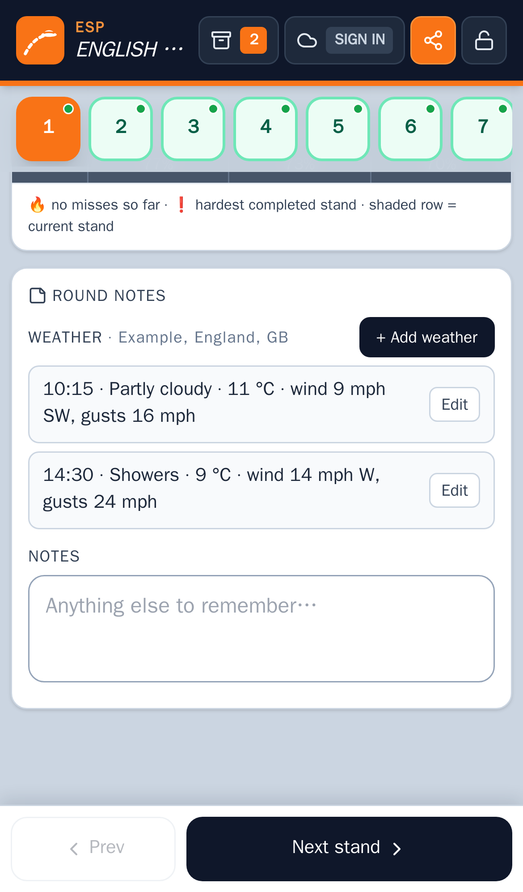

- **Your location** is only sent to Open-Meteo to look up the weather. It works only when the app is opened over `https://`; otherwise use **Search**.
- **Offline**, *Get weather* can't reach the service. Enter the weather by hand instead.
- **Where the weather appears:** on the PDF, in the CSV export (and comes back on import), and on the Presentation cover.

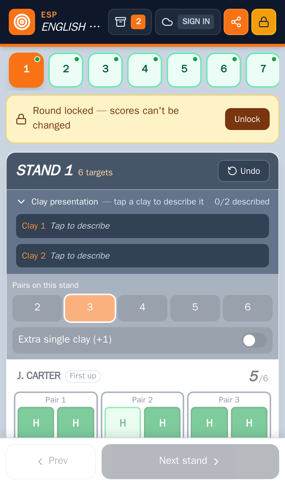

**Locking a round.** Tap **Lock** in the header once a round is finished. A yellow banner shows the round is locked:

- scores can't be changed;
- **Prev** and **Next** are switched off;
- the scoring area is dimmed.

Tap **Unlock**, on the banner or in the header, to make changes again.

---

## 7. Round history

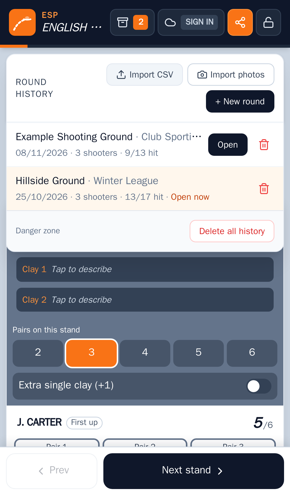

Tap **History** in the header. Every round with a ground or event name is kept here automatically, newest shoot date first. Each entry shows the date, number of shooters and hits so far. The round you're on is marked **Open now**.

| Action | What it does |
|---|---|
| **Open** | Switches to that round (the current round stays in History) |
| Bin icon | Deletes that round, after asking. When signed in, it is deleted from the server too |
| **+ New round** | Starts a fresh round; the current one stays in History |
| **Import photos into this round** | On its own line below. Fills in the open round from scorecard photos. Only shown while it has no scores (see below) |
| **Import CSV** | Loads a round from a CSV exported by ClayScorer (see below) |
| **Delete all history** | Removes every saved round for this discipline, after asking |

A round's identity is its **ground + date + event**. If you change any of these, the History entry is updated rather than copied. A round with no ground and no event isn't saved to History.

**Importing a CSV:**

- **Same discipline only.** Import on the same discipline's page: a Sportrap CSV can't be imported into Skeet.
- **Fixed layouts must match.** For Sportrap, Compak and Skeet, the stand layout must match.
- **The round needs a name.** It must have a ground or event name.
- **What happens.** The round is added to History, and the app offers to open it.

### Importing scorecard photos

Paper scorecards can be turned into a round. Open **Import scorecard photos** from the home page. You need to be signed in, and the server's administrator has to have set the feature up.

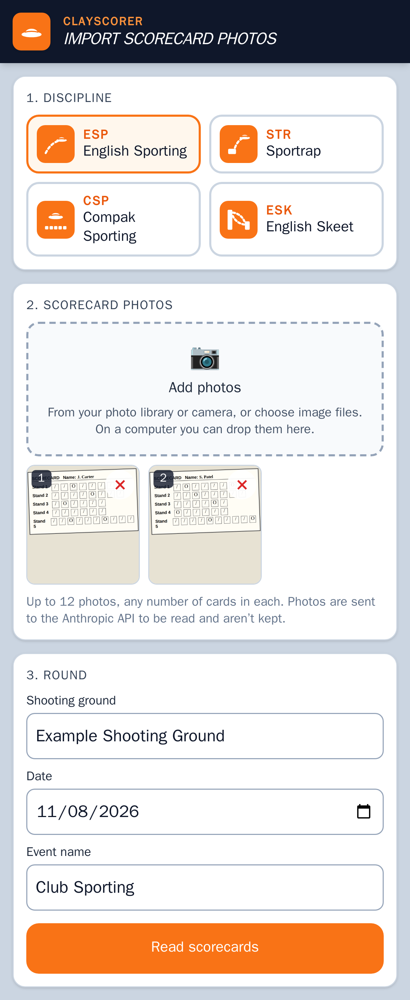

1. **Discipline.** Pick what the cards are for. From History, it is already chosen.
2. **Photos.** Tap **Add photos** to choose from your photo library, take a photo, or pick image files. On a computer you can also drag files onto the box. You can add up to 12 photos, and a photo can hold several cards. Tap **×** to remove a photo.
3. **Round.** Enter a ground or event name (you need at least one) and the date, then tap **Read scorecards**. Reading takes up to about a minute.

The photos are sent to the Anthropic API (Claude) to be read. They aren't kept, either by ClayScorer or as part of the round. If an iPhone HEIC photo won't open, export it as JPEG first.

**Check the cards.** The summary at the top shows the stands that will be created. For English Sporting, each stand gets the **highest number of clays on any card**. An odd number becomes pairs plus a +1 single. Cards with fewer clays on a stand leave the rest as not shot. Sportrap, Compak and Skeet keep their fixed layouts, and you get a warning if a card doesn't fit.

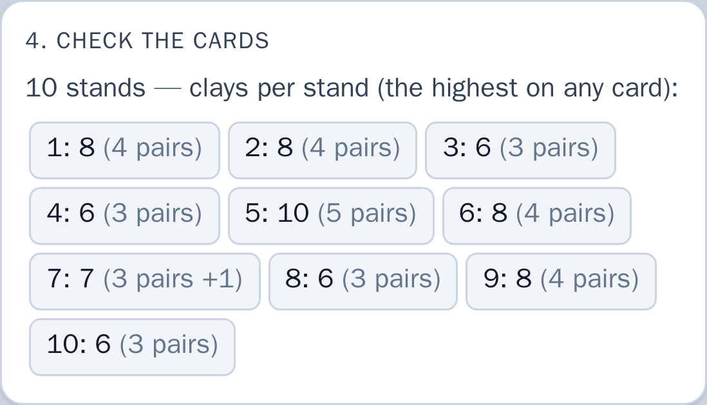

Each card then shows what was read:

- **Shooter.** If the name on the card matches one of your [regular shooters](#regular-shooters), it is matched automatically and their CPSA number, class and gear are used. Matching ignores case and accepts initials ("P. Sargent" matches "Paul Sargent"). Change the match with the drop-down, or choose **New shooter** and type the name.
- **Clays.** Green **H** is a hit, red **M** is a miss and **·** is not shot. Tap a clay to change it: hit, then miss, then not shot.
- **Doubtful marks** have an amber outline, with the reason under the stand, for example an overwritten mark. Check these against the photo.
- **Written scores.** Each stand's count is compared with any score written on the card. A difference shows **✗ — check** in red. The total is compared the same way.
- **Include.** Untick a card to leave it out. A round holds up to 10 shooters.

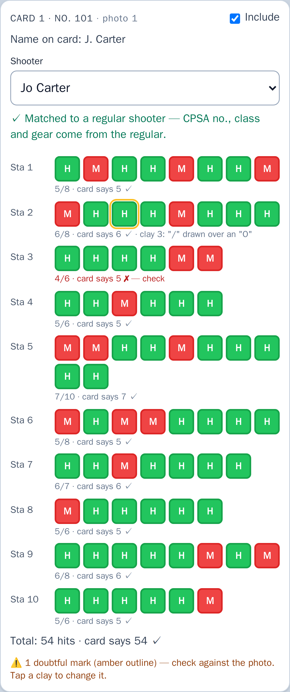

Tap **Create round**. The discipline page opens with the new round, which is also saved in History. If a round with the same ground, date and event already exists, you're asked before it is replaced.

**Into a round you've already set up.** You may have set up a round before shooting, with the squad and clay presentations entered, and kept score on paper. You can fill it in from the scorecards as long as it has no scores yet. Tap **Fill in this round from scorecard photos** under the squad in **Round setup**, or **History › Import photos into this round**.

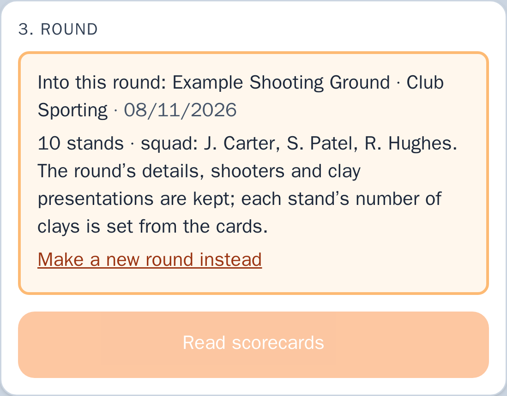

- **What's kept.** The round keeps its ground, date, event, notes, weather and clay presentations, so you don't enter them again.
- **Shooters.** Cards are matched to the round's shooters first, then to your regulars. A matched shooter keeps their details from the round. Shooters without a card stay in the squad with no scores, and unused "Shooter N" rows are removed.
- **Clays per stand.** For English Sporting, each stand's number of clays is set from the cards, again the highest on any card. The summary shows **was 6** where a stand changes. Stands not on the cards stay as they were.
- **Changed your mind?** Tap **Make a new round instead** to import the cards as a separate round.

Tap **Add … cards to this round** to finish. If the round was scored or changed in the meantime, nothing is imported and you're told why.

---

## 8. Exporting and sharing

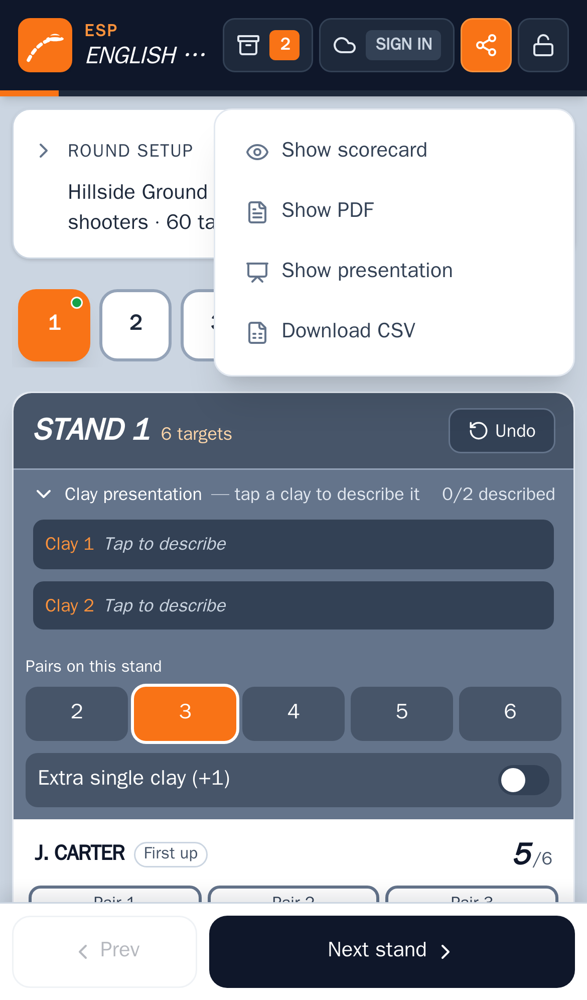

Tap the orange **Export** button:

- **Show scorecard.** The scorecard as an image, plus a presentations image if any clays are described.
- **Show PDF.** The printable scorecard as A4 landscape pages: ground, discipline, date, event, every shooter's hits and misses (highest total first), totals, weather and notes. If any clays are described, the presentations follow on their own pages.
- **Show presentation.** A slide deck about the round, with stats, charts, awards and some friendly roasting (see [Presentation](#presentation) below).
- **Download CSV.** A spreadsheet-friendly file with the round details, per-stand totals and every shot. It can be imported again later (see [Round history](#7-round-history)).

The first three open full screen inside the app. Tap an image or page to zoom in and scroll. Each viewer has the same buttons:

| Button | Show scorecard | Show PDF | Show presentation |
|---|---|---|---|
| **Share** | Sends the image(s) | Sends a `.pdf` file | Sends the slides as a `.pdf` file |
| **Save** (computers only) | Downloads the `.png` image(s) | Downloads the `.pdf` file | Downloads the slides as a `.pdf` file |
| **Print** | Prints the image(s), one per page | Opens the print dialog with the scorecard (choose *Save as PDF* there for a sharper file) | Prints one slide per page |
| **Close** | Back to scoring | Back to scoring | Back to scoring |

**Share** opens your phone's share sheet (Messages, WhatsApp, email…); on a computer the file downloads instead. **Save** only appears on a computer (with a mouse or trackpad) and always downloads the files straight to your Downloads folder. On a phone, use **Share** and pick *Save to Files* or *Save image*.

How the scorecards look:

- **Colours:** hits are **green** and misses are **red**. Unshot targets are blank.
- **Order:** shooters are listed by total score, highest first.
- **Names:** multi-word names are split one word per line.
- **Filenames:** all exports share a name built from the date, discipline, ground and event, e.g. `20261108_sporting_example-shooting-ground_club-sporting.png`.

See [example-outputs.pdf](example-outputs.pdf) for full examples of every discipline.

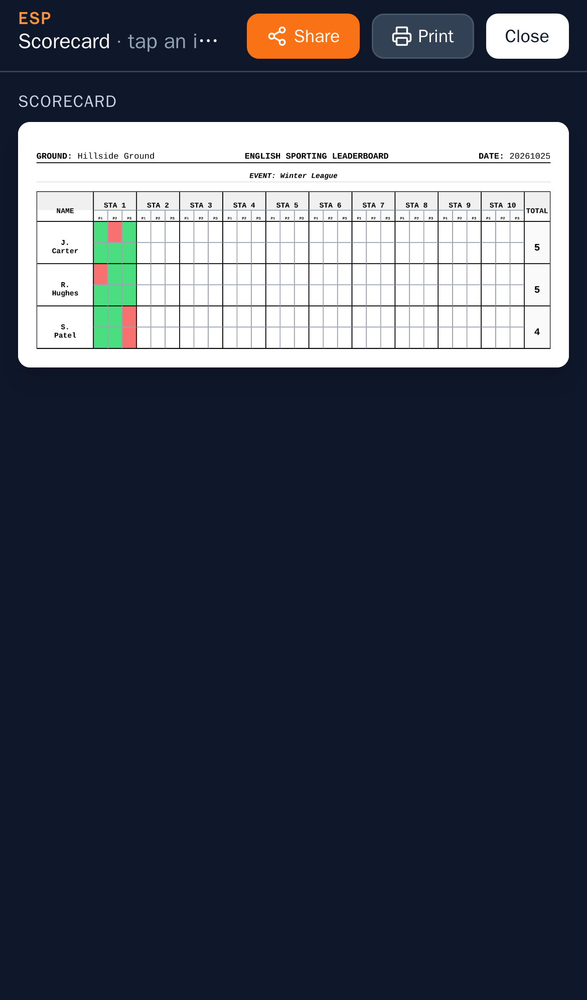

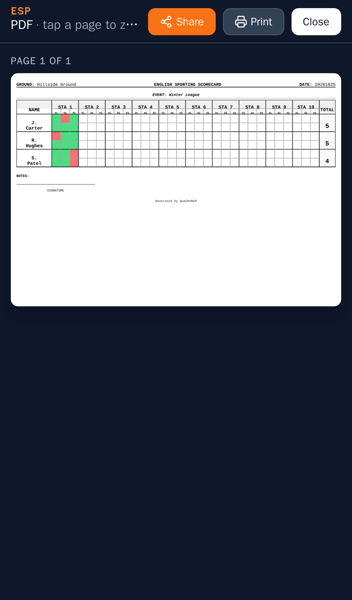

### Presentation

**Export › Show presentation** turns the current round into a 16:9 slide deck. It works for every discipline, and it's built from the round's scores, so score some targets first.

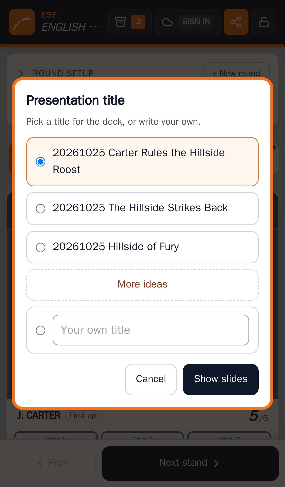

1. **Pick a title.** The app suggests three. Each starts with the date and names the ground or event, mixed with the squad hit rate, who won and by how much, and the weather if recorded (e.g. *20261108 Kelly-Smith Beats the Wind at Winter League*). Tap **More ideas** for another three, or type your own. The title you choose is remembered with the round.
   - **Tone and Write with AI** (at the top of the window, when signed in and if the server has an Anthropic API key): choose a **Tone** (Gentle, Cheeky or Savage; Cheeky is the default) and tap **Write with AI**. After a few seconds the title list shows the AI's title ideas, marked **AI**, with the first one selected. **More ideas** still gives the built-in ones. The cover gag, roasts, slide verdicts, award names and closing lines are written by Claude too. They're stored with the round, so the slideshow, Share, Save and Print all match and it works offline afterwards. **Rewrite with AI** gets a fresh set (for example after changing the tone), and **Use built-in jokes** switches back to the app's own lines at any time. If you change the scores or notes afterwards, the deck goes back to the built-in jokes until you write again.

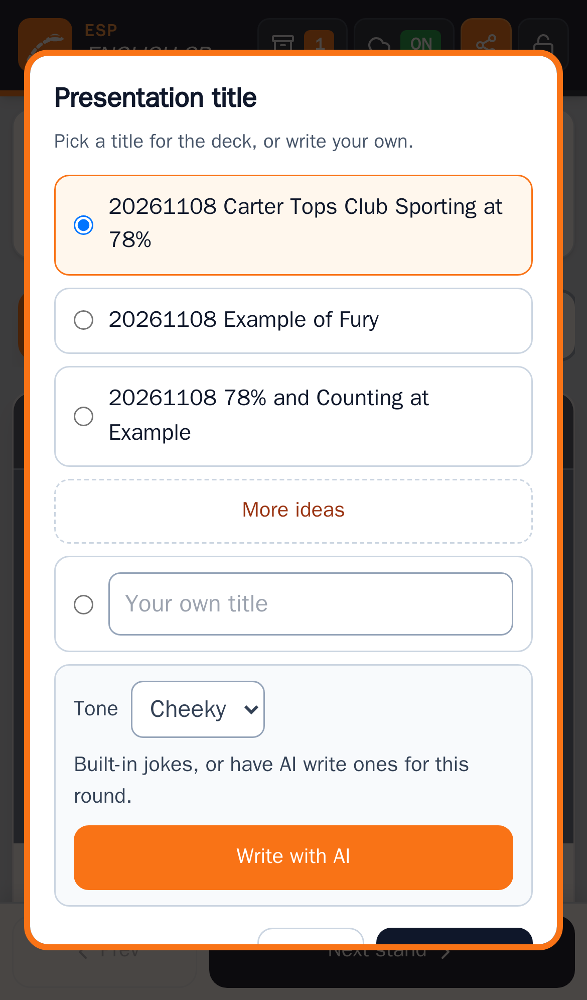

2. **Show slides** opens a full-screen slideshow. Swipe, or use **Prev** / **Next**, to move between slides; on a computer the arrow keys work too. **Notes** shows the speaker notes for each slide, with the raw numbers behind it. The slides are easier to read with the phone turned sideways.
3. **Share** sends the deck as a 16:9 `.pdf` file, one slide per page. On a computer, **Save** downloads that file. **Print** prints it one slide per page; choose *Save as PDF* in the print dialog for a sharper file.

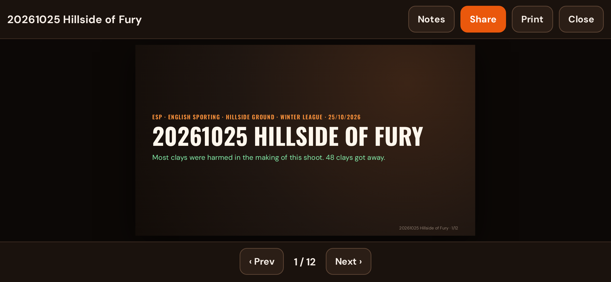

**The slides**

| Slide | What it shows |
|---|---|
| Cover | The title, a one-line gag, and a line about the weather if any was recorded |
| The squad | Each shooter's clays, gun and cartridges (if filled in) and a roast line, plus squad totals. If the gun and cartridge details are long, or there are more than six shooters, they move to their own **The kit** slide straight after. Roasts can mention the recorded weather (rain, wind, gusts, cold, heat) or a shooter's best and worst clay type |
| Podium | Top three by hit rate |
| Milestones | Hits after the first 6 / 8 / 10 / 12 clays of **every** stand, and who led at each point. Only on stands longer than that, so usually English Sporting only |
| Stand by stand | Every shooter's hits and % per stand, plus the squad, colour-banded: green 80%+, blue 60–79%, amber 40–59%, red-orange under 40%. The % is always shown, so you don't need to rely on colour |
| Hit rate per stand | Line chart per shooter, with the disaster stand shaded. Where shooters share a value, their lines are drawn side by side so none is hidden |
| Running total | Cumulative hits, with lead changes marked. Shared values are drawn side by side, as above |
| Barrel by barrel | 1st and 2nd barrel hit rates, **doubles** (both hit) and **blanks** (both missed). Pairs only: Sporting pairs, Sportrap/Compak on-report and sim pairs, Skeet doubles. Singles and the +1 clay aren't counted, and the slide is left out if there are no pairs |
| Clay types | Hit rate per shooter and for the squad for each presentation (Crosser, Teal …) and distance band (close, medium, far). Comes from the [clay presentation](#5-describing-clay-presentations) descriptions, and only appears when clays have been described |
| Streaks and slumps | Longest run of hits and of misses, in card order across stands, with where each started and ended |
| Stand stories | Best stand, worst stand, and the biggest gap between two shooters on one stand |
| Awards | Comic awards for the bests and the worsts, each with the stat behind it, including a specialist on the most common clay type and a **Nemesis** for someone's worst type |
| Score check | Totals counted three ways to show they agree, and any clays not shot yet |
| Final scores | Ranking and a closing gag |

- **Each shooter keeps one colour and marker shape** on every slide. Names always stay on one line next to their colour dot.
- **Long text is fitted to the slide.** If a table would run off the bottom, its text is made smaller until it fits.
- **Everyone is compared by hit rate**, so a shooter with fewer clays isn't penalised.
- **Unscored clays are left out** of every rate rather than counted as misses.
- **One overall roast per slide.** The kit, Milestones, Barrel by barrel, Streaks and slumps, Stand stories and Awards each have a one-line verdict under the heading, built from that slide's numbers (e.g. who led wire to wire, which barrel let the squad down, who left the awards empty-handed).
- **Round notes join in.** A sentence in the round's **Notes** that names a shooter is quoted after their roast on the squad slide. The final slide adds a line about the notes: a joke if they mention something it recognises (trap trouble, new kit, a debut, a birthday, something forgotten, a late start, food and drink, a busy ground, the conditions, a competition, coaching), otherwise a quote of the first sentence. The notes are only quoted or matched on keywords; nothing is read into them.
- **The jokes vary.** Each situation has several possible lines. The mix depends on the round and the title, so the same deck always reads the same on screen, in the PDF and when printed. Pick a different title to get a different set. No two shooters on the squad slide get the same line.
- **AI-written jokes are checked.** Claude is only given the round's numbers, names, weather, clay descriptions and notes, and told to stick to them. Any line with a number, percentage or stand that isn't in the round is dropped and the built-in line is used instead. The round's names, scores, weather and notes are sent to Anthropic to do this.
- **The jokes come only from the numbers.** Weather lines only use the weather recorded in Round notes, and clay-type lines only use the clay descriptions. Nothing is invented.

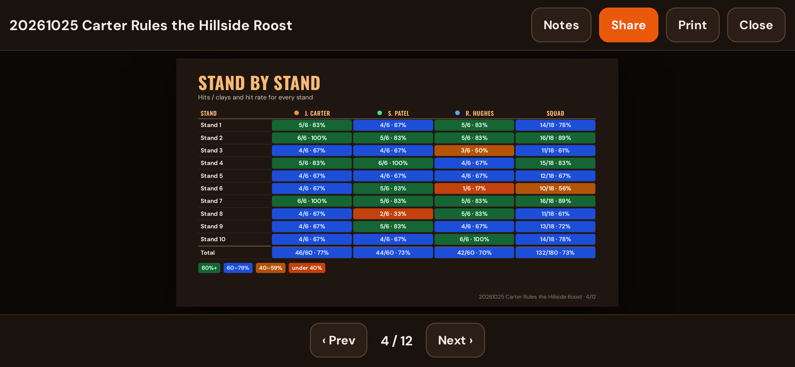

See the end of [example-outputs.pdf](example-outputs.pdf) for a full example deck.

---

## 9. Signing in and syncing

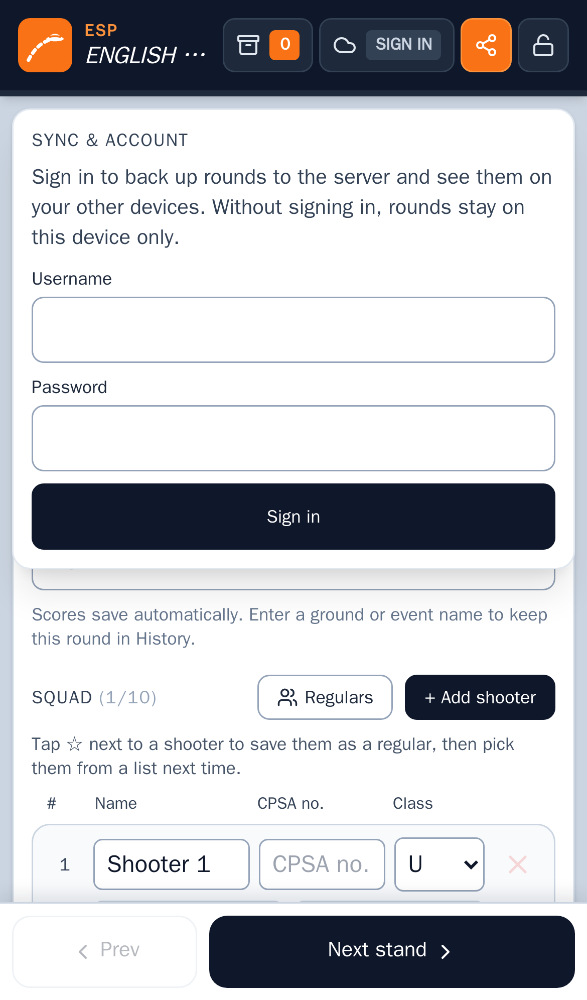

Signing in backs up your rounds to the server and lets you see them on your other devices. You don't need to sign in to score; without it, rounds stay on that device only.

Tap the **cloud** button in the header and sign in with the username and password your administrator gave you. The cloud button's tag shows the status:

| Tag | Meaning |
|---|---|
| **Sign in** | Not signed in |
| **On** | Signed in and up to date (the panel shows when it last synced) |
| **Sync** | Syncing now |
| **Offline** | No connection. Changes sync when you're back online |
| **Error** | The last sync failed. Open the panel to see why, then tap **Sync now** |
| **Off** | This copy of the app has no server (scores are saved on the device only) |

How syncing works:

- **What syncs:** rounds in History, meaning rounds with a ground or event name, and your [regular shooters](#regular-shooters). A round with no name is not synced.
- **When:** changes are sent automatically a moment after you make them. The app also checks for changes from your other devices when it opens, when you sign in, when the connection comes back, and when you return to it. **Sync now** forces a check.
- **Same round on two devices:** the most recent change wins.
- **Deleting:** deleting a round when signed in deletes it from the server and your other devices.
- **Signing out:** the rounds already on the device stay there.

---

## 10. Your account and managing users

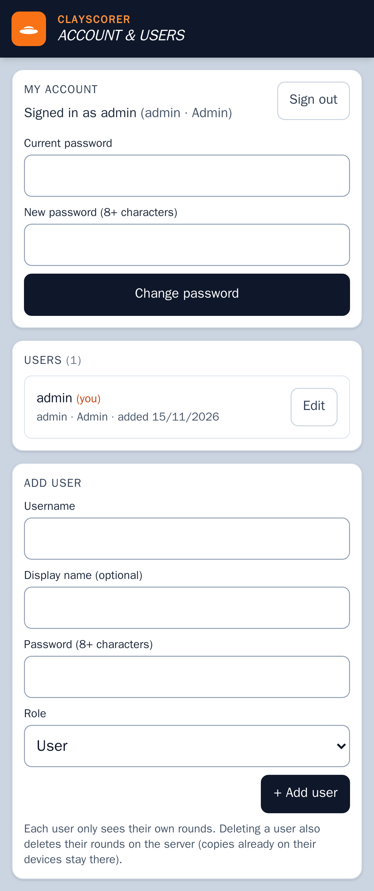

Open **Account & users** from the bottom of the home page.

- **Sign in / Sign out.**
- **Change password.** Enter your current password and a new one (8 or more characters). Your other devices are signed out.

**Administrators** also see:

- **Users:** everyone with an account. **Edit** changes a user's username, display name or role (User or Admin), or resets their password, which signs that user out everywhere. **Delete** removes the user *and all their rounds on the server*. Copies already on their devices stay there.
- **Add user:** username, optional display name, password (8 or more characters) and role.

Each user only sees their own rounds. You can't delete your own account or the last remaining admin.

---

## 11. Tips and troubleshooting

- **The app looks out of date after an update.** Close and reopen it, or reload the page, once or twice. The app caches itself for offline use and picks up new versions on the next load.
- **Rounds are saved per device and per browser.** Clearing your browser's site data, or using a private/incognito window, removes rounds that haven't been synced. Sign in if you want a backup.
- **Different web addresses keep separate data.** Rounds saved while using the app at one address aren't visible at another address, even on the same phone. To move them, sign in at both, or export a CSV and import it.
- **Scorecard photos not read well?** Take each photo straight on, in good light, with the whole card in the frame. Fewer cards per photo helps.
- **Nothing in History?** Only rounds with a ground or event name are saved there. Add a name in **Round setup**.
- **Scored the wrong shooter?** Tap **Undo** straight away, or tap the wrong button again to clear it, then score the right shooter.
- **Can't change anything?** The round is probably locked. Look for the yellow banner and tap **Unlock**.
