# ClayScorer Pro — User Guide

ClayScorer Pro scores CPSA clay shooting rounds on your phone, tablet or computer. It covers four disciplines:

| Code | Discipline | Layout |
|---|---|---|
| **ESP** | English Sporting | You choose the number of stands (1–20) and pairs per stand (2–6), with an optional +1 single clay on any stand |
| **STR** | Sportrap | 5 rounds × 5 targets = 25 |
| **CSP** | Compak Sporting | 5 rounds × 5 targets = 25 |
| **ESK** | English Skeet | 7 stations, the standard CPSA sequence (H / L / H+L / L+H) plus the option target |

Screenshots are from an iPhone. Names and grounds in them are made up. For what the printed and shared scorecards look like for every discipline, see [example-outputs.pdf](example-outputs.pdf).

**Contents**

1. [Getting started](#1-getting-started)
2. [Setting up a round](#2-setting-up-a-round)
3. [Scoring](#3-scoring)
4. [Discipline notes](#4-discipline-notes)
5. [Describing clay presentations](#5-describing-clay-presentations)
6. [Leaderboard, notes and locking](#6-leaderboard-notes-and-locking)
7. [Round history](#7-round-history)
8. [Exporting and sharing](#8-exporting-and-sharing)
9. [Signing in and syncing](#9-signing-in-and-syncing)
10. [Your account and managing users](#10-your-account-and-managing-users)
11. [Tips and troubleshooting](#11-tips-and-troubleshooting)

---

## 1. Getting started

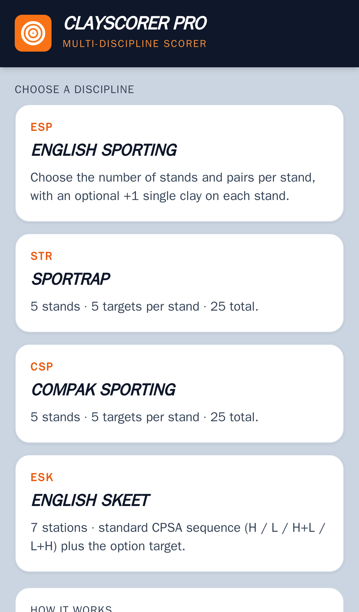

Open the app's web address and pick a discipline. Each discipline keeps its own rounds, so a Sporting round and a Skeet round never get mixed up.

If a discipline has a round in progress, its tile shows **Continue: …** with the ground or event and how many targets have been scored.

**Install it on your phone** so it opens full screen like an app:

- **iPhone / iPad (Safari):** tap **Share**, then **Add to Home Screen**.
- **Android (Chrome):** tap the **⋮** menu, then **Add to Home screen** or **Install app**.

**It works without signal.** Once the app has been opened while online, it keeps working offline. Scores are saved on the device as you tap, and an **Offline** tag appears in the header while there's no connection.

**The header**, on every discipline page:

| Button | What it does |
|---|---|
| Target logo | Back to the discipline list |
| **History** (box icon + count) | Saved rounds, Import CSV, New round — see [Round history](#7-round-history) |
| **Cloud** | Sign in and sync — see [Signing in and syncing](#9-signing-in-and-syncing) |
| **Export** (orange) | Print/PDF, Show scorecard, Share image, CSV — see [Exporting and sharing](#8-exporting-and-sharing) |
| **Lock** | Lock the round so scores can't be changed |

The thin orange bar under the header shows how much of the round has been shot.

---

## 2. Setting up a round

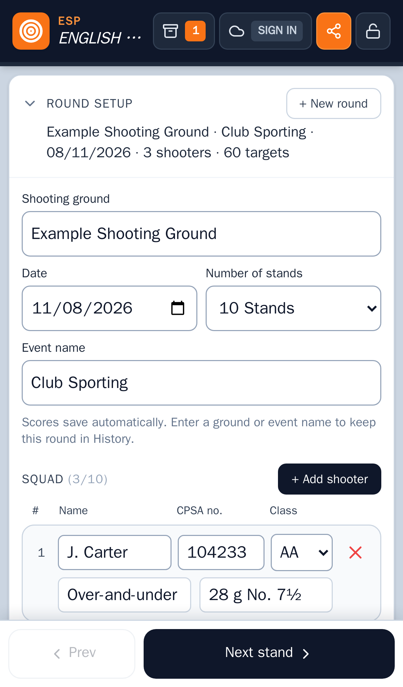

Open **Round setup** at the top of the page.

- **Shooting ground**, **Date** and **Event name.** Fill in a ground or an event name to keep the round in History. Rounds with neither are not saved to History.
- **Number of stands** (English Sporting only), from 1 to 20. Sportrap, Compak and Skeet show their fixed format instead.
- **Squad:** tap **+ Add shooter**, up to 10 shooters. Each has a **Name**, an optional **CPSA no.** and a **Class** (AAA, AA, A, B, C, U). Tap the red **×** to remove a shooter. If they have scores, you're asked to confirm first. A round always keeps at least one shooter.
- **+ New round** starts a fresh round. The current one stays in History.

Everything saves automatically; there's no Save button.

Once the first target is scored, Round setup folds away to give the scoring more room. Tap its heading to open it again. A one-line summary (ground, event, date, shooters, targets) stays visible.

---

## 3. Scoring

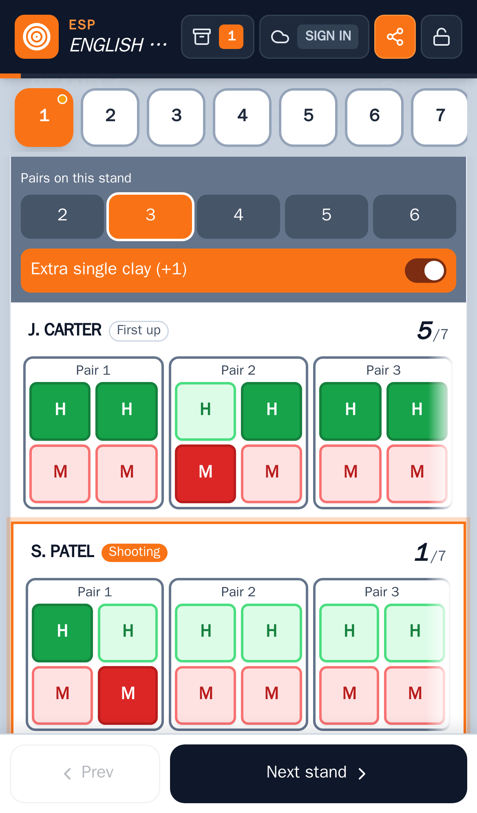

**Moving between stands.** The numbered buttons under the header take you to a stand: **R1–R5** for rounds on Sportrap and Compak, stations on Skeet. You can also use **Prev** and **Next** at the bottom. A small dot on a stand button shows its progress: amber while it's partly shot, green once the whole squad has finished it. A finished stand's button also turns light green.

**Recording a target.** Each shooter has a row of boxes, grouped as they are thrown: *Pair 1, Pair 2…* on Sporting, *Single / On report / Sim pair* on Sportrap and Compak.

- Tap **H** for a hit or **M** for a miss. The chosen button turns solid green or red.
- Tap the same button again to clear it back to "not shot".
- **Undo** (top right of the stand) reverses the last tap. It goes back one step only.

**Who's shooting.** An orange **Shooting** tag and outline mark the first shooter who hasn't finished the stand. On English Sporting the shooting order rotates each stand; the **First up** tag shows who leads, and they're listed first.

**Scrolling scores on phones.** On English Sporting and Compak, each shooter's row scrolls sideways on a phone, with about three pairs in view. A soft fade at the edge means there's more to see. The row remembers where you scrolled, opens on the shooter's next unshot pair when you change stand, and slides on to the next pair when you finish one. Sportrap and Skeet rows wrap onto a second line instead when they don't fit.

---

## 4. Discipline notes

### English Sporting (ESP)

On each stand, under **Pairs on this stand**, choose 2–6 pairs. Switch on **Extra single clay (+1)** if the stand has an extra single. The extra clay is scored on its own, shown with an orange dashed outline.

### Sportrap (STR) and Compak (CSP)

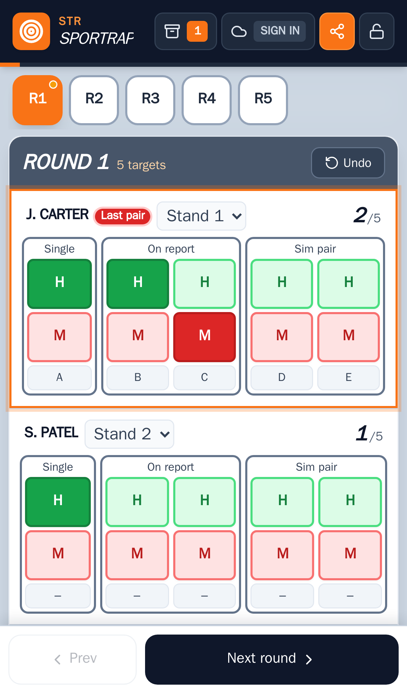

A **round** (R1–R5) is one pass of the squad. Each shooter starts each round on a physical **stand** (1–5); the stand picker next to each name sets this. By default shooters rotate one stand per round.

Under **Round setup › Stand setup** you set, for each physical stand, how its clays are thrown (**Single**, **On report** or **Sim pair**) and which presentation each clay is (A, B, C…). The scoring rows follow that layout, and each box shows its presentation letter.

The **Presentations** panel above the scoring card is where you describe each presentation (see [section 5](#5-describing-clay-presentations)). Compak has seven presentations (1/A–7/G) by default; **+ Presentation** adds another.

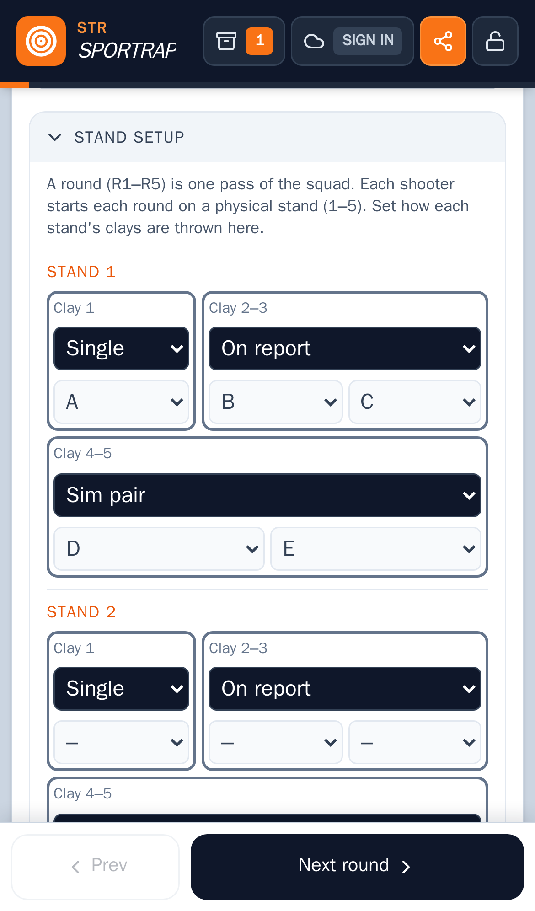
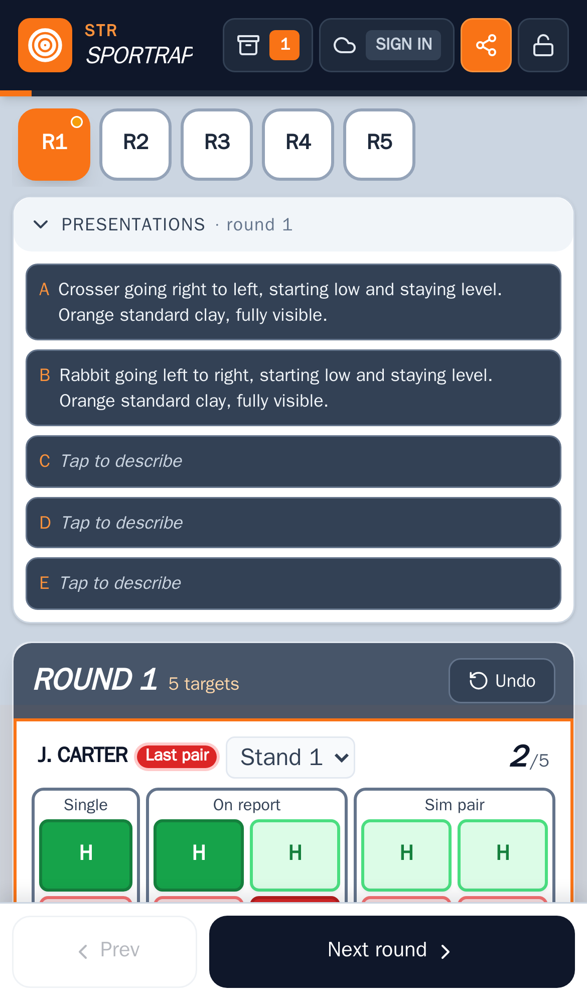

### English Skeet (ESK)

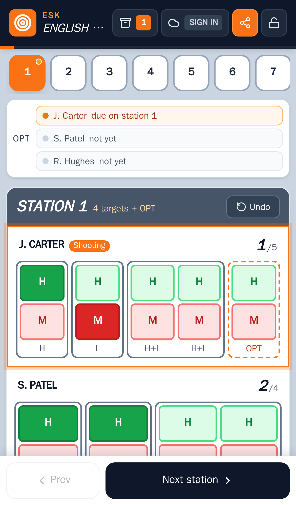

Each box is labelled with what is thrown: **H** high house, **L** low house, **H+L** / **L+H** a double, with the first-named bird thrown first.

**Option target (OPT).** The panel above the scoring card tracks each shooter's option target:

- **not yet:** no miss so far.
- **due on station N:** the shooter's first miss was on station N. Score the re-shoot there in the dashed **OPT** box.
- **used on station N:** already shot.

A shooter who is straight after 24 targets takes the option on station 7.

---

## 5. Describing clay presentations

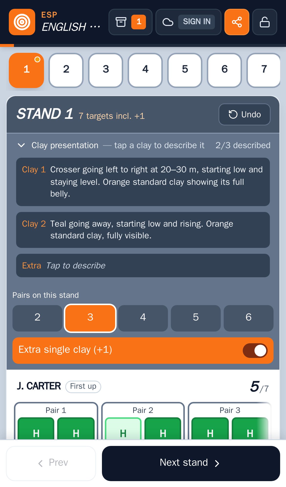

You can record how each clay is presented. It's optional, and it doesn't affect scores. The descriptions appear in the app and on a separate page of the printed and shared scorecards.

- **English Sporting:** the **Clay presentation** section sits in each stand's scoring card, with one button per clay (Clay 1, Clay 2, and Extra for a +1). The heading shows how many clays are described, e.g. *2/3 described*. Tap the heading to show or hide the section; each device remembers your choice.
- **Sportrap and Compak:** use the **Presentations** panel. It describes presentations A, B, C… for the current round.

Tap a clay to open its description window:

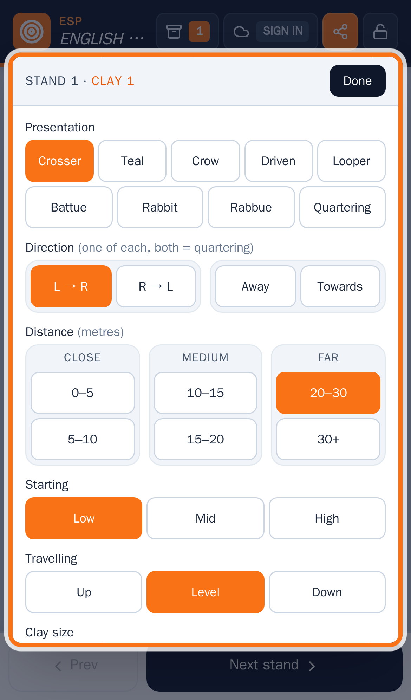

| Field | Options | Notes |
|---|---|---|
| Presentation | Crosser, Teal, Crow, Driven, Looper, Battue, Rabbit, Rabbue, Quartering | |
| Direction | **L → R** or **R → L**, and **Away** or **Towards** | Pick up to one from each group. Picking one of each describes the clay as *quartering away* or *quartering towards* |
| Distance (metres) | Close: 0–5, 5–10 · Medium: 10–15, 15–20 · Far: 20–30, 30+ | |
| Starting | Low, Mid, High | Default **Low** |
| Travelling | Up, Level, Down | Default **Level** |
| Clay size | Std110, Midi90, Mini70 | Default **Std110** |
| Clay face | Edge, Belly, Top | Choosing **Edge** clears Clay face amount |
| Clay face amount | Full, Part | Default **Full** |
| Colour | Orange, Black, Pink, Green | Default **Orange** |

- **Defaults.** A clay you haven't described yet shows the defaults already selected. They're saved as soon as you change anything on that clay.
- **Clearing a choice.** Tap a selected option again to clear it.
- **Closing.** Tap **Done**, tap outside the window, or press Escape.

The description builds itself as you go and is shown at the bottom of the window and on the clay's button. For example:

> Crosser quartering away left to right at 20–30 m, starting low and rising. Orange standard clay showing its full belly.

---

## 6. Leaderboard, notes and locking

**Leaderboard.** Below the scoring card is a table with a row for each stand and a column for each shooter, plus totals.

- 🔥 next to a shooter's name means no misses so far.
- ❗ marks the hardest completed stand: the one the squad scored worst on, on average.
- The shaded row is the stand you're on.

**Round notes.** A free-text box for weather, conditions or anything else. Notes are saved with the round and printed on the PDF.

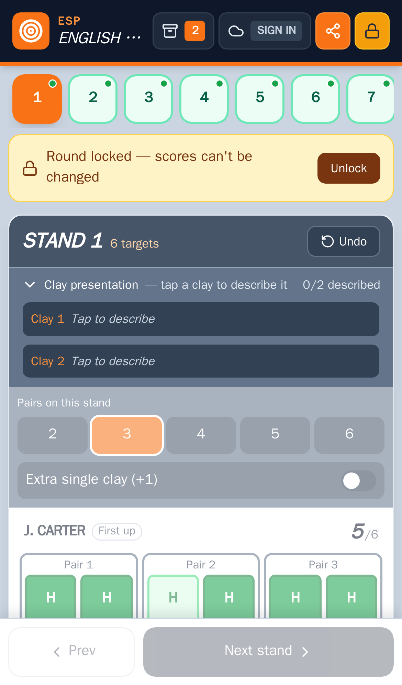

**Locking a round.** Tap **Lock** in the header once a round is finished. A yellow banner shows the round is locked:

- scores can't be changed;
- **Prev** and **Next** are switched off;
- the scoring area is dimmed.

Tap **Unlock**, on the banner or in the header, to make changes again.

---

## 7. Round history

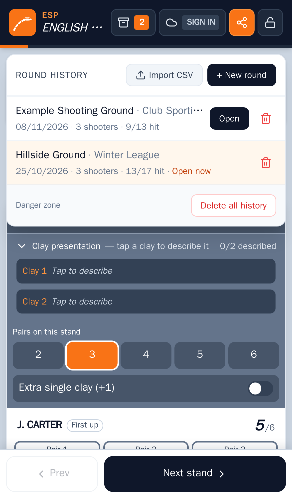

Tap **History** in the header. Every round with a ground or event name is kept here automatically, newest shoot date first. Each entry shows the date, number of shooters and hits so far. The round you're on is marked **Open now**.

| Action | What it does |
|---|---|
| **Open** | Switches to that round (the current round stays in History) |
| Bin icon | Deletes that round, after asking. When signed in, it is deleted from the server too |
| **+ New round** | Starts a fresh round; the current one stays in History |
| **Import CSV** | Loads a round from a CSV exported by ClayScorer (see below) |
| **Delete all history** | Removes every saved round for this discipline, after asking |

A round's identity is its **ground + date + event**. If you change any of these, the History entry is updated rather than copied. A round with no ground and no event isn't saved to History.

**Importing a CSV:**

- **Same discipline only.** Import on the same discipline's page: a Sportrap CSV can't be imported into Skeet.
- **Fixed layouts must match.** For Sportrap, Compak and Skeet, the stand layout must match.
- **The round needs a name.** It must have a ground or event name.
- **What happens.** The round is added to History, and the app offers to open it.

---

## 8. Exporting and sharing

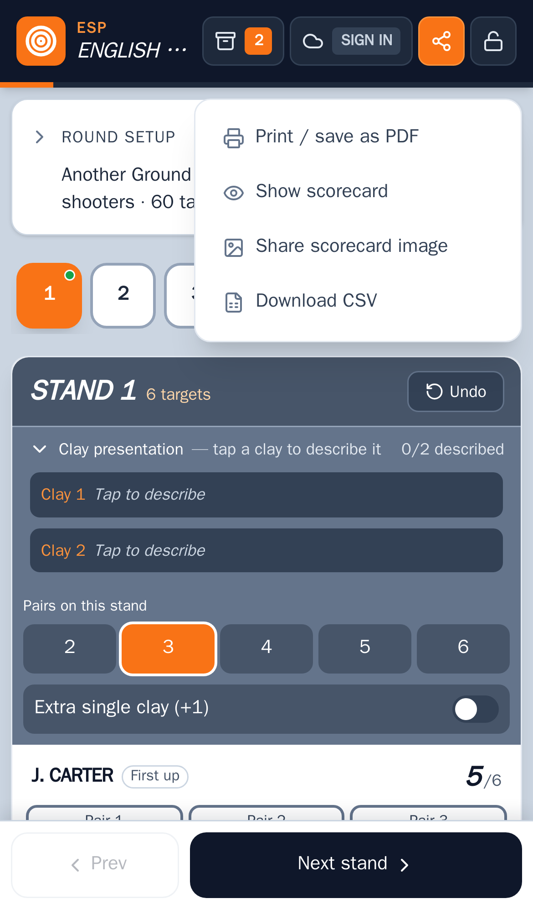

Tap the orange **Export** button:

- **Print / save as PDF.** Opens the print dialog with a printable scorecard: ground, discipline, date, event, every shooter's hits and misses, totals, notes and a signature line. If any clays are described, the presentations follow on a separate page. To get a PDF file, choose *Save as PDF* in the print dialog.
- **Show scorecard.** Shows the scorecard image inside the app, plus a presentations image if any clays are described. Tap an image to zoom in and scroll; tap **Share** to send it, or **Close** to go back.
- **Share scorecard image.** Creates the same image(s) and opens your phone's share sheet (Messages, WhatsApp, email…). On a computer the images download instead.
- **Download CSV.** A spreadsheet-friendly file with the round details, per-stand totals and every shot. It can be imported again later (see [Round history](#7-round-history)).

How the scorecards look:

- **Colours:** hits are **green** and misses are **red**. Unshot targets are blank.
- **Order:** shooters are listed by total score, highest first.
- **Names:** multi-word names are split one word per line.
- **Filenames:** all exports share a name built from the date, discipline, ground and event, e.g. `20261108_sporting_example-shooting-ground_club-sporting.png`.

See [example-outputs.pdf](example-outputs.pdf) for full examples of every discipline.

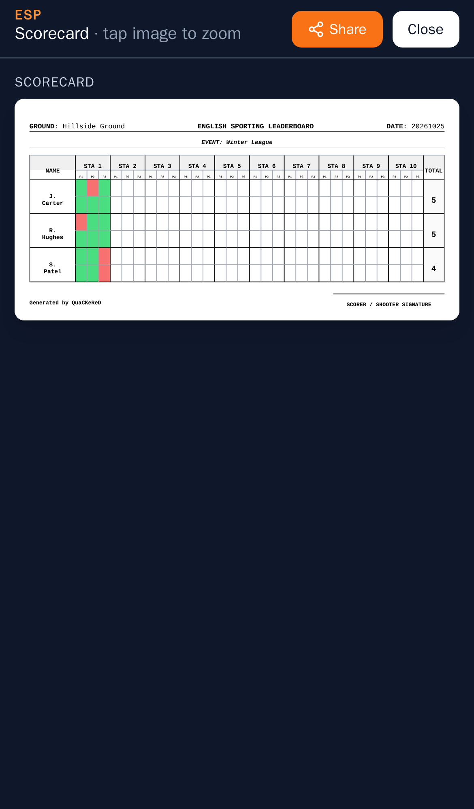

---

## 9. Signing in and syncing

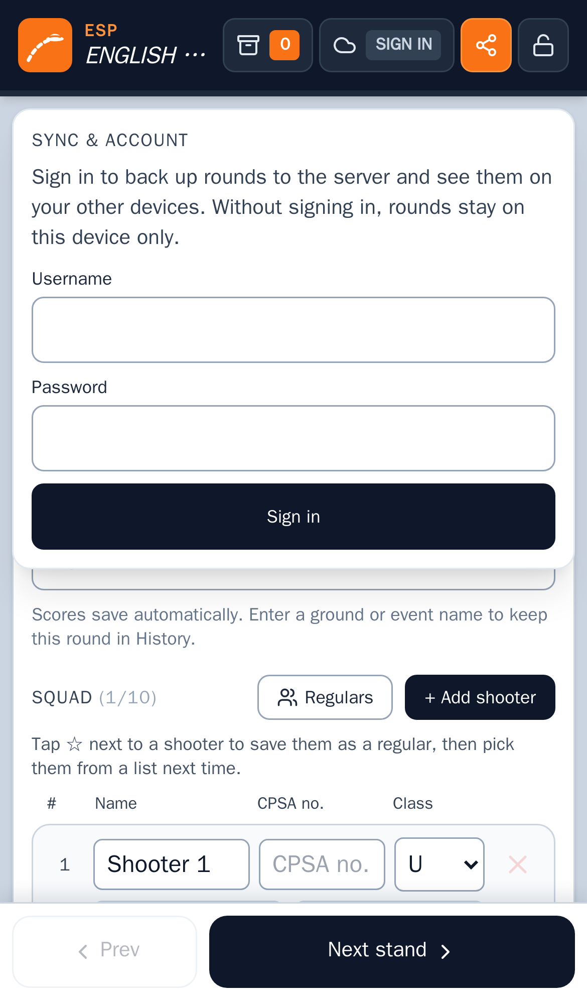

Signing in backs up your rounds to the server and lets you see them on your other devices. You don't need to sign in to score; without it, rounds stay on that device only.

Tap the **cloud** button in the header and sign in with the username and password your administrator gave you. The cloud button's tag shows the status:

| Tag | Meaning |
|---|---|
| **Sign in** | Not signed in |
| **On** | Signed in and up to date (the panel shows when it last synced) |
| **Sync** | Syncing now |
| **Offline** | No connection. Changes sync when you're back online |
| **Error** | The last sync failed. Open the panel to see why, then tap **Sync now** |
| **Off** | This copy of the app has no server (scores are saved on the device only) |

How syncing works:

- **What syncs:** rounds in History, meaning rounds with a ground or event name. A round with no name is not synced.
- **When:** changes are sent automatically a moment after you make them. The app also checks for changes from your other devices when it opens, when you sign in, when the connection comes back, and when you return to it. **Sync now** forces a check.
- **Same round on two devices:** the most recent change wins.
- **Deleting:** deleting a round when signed in deletes it from the server and your other devices.
- **Signing out:** the rounds already on the device stay there.

---

## 10. Your account and managing users

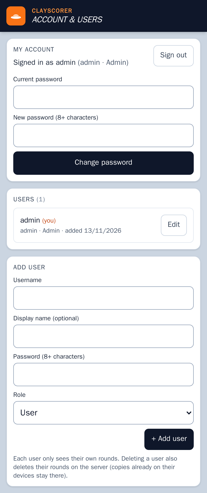

Open **Account & users** from the bottom of the home page.

- **Sign in / Sign out.**
- **Change password.** Enter your current password and a new one (8 or more characters). Your other devices are signed out.

**Administrators** also see:

- **Users:** everyone with an account. **Edit** changes a user's username, display name or role (User or Admin), or resets their password, which signs that user out everywhere. **Delete** removes the user *and all their rounds on the server*. Copies already on their devices stay there.
- **Add user:** username, optional display name, password (8 or more characters) and role.

Each user only sees their own rounds. You can't delete your own account or the last remaining admin.

---

## 11. Tips and troubleshooting

- **The app looks out of date after an update.** Close and reopen it, or reload the page, once or twice. The app caches itself for offline use and picks up new versions on the next load.
- **Rounds are saved per device and per browser.** Clearing your browser's site data, or using a private/incognito window, removes rounds that haven't been synced. Sign in if you want a backup.
- **Different web addresses keep separate data.** Rounds saved while using the app at one address aren't visible at another address, even on the same phone. To move them, sign in at both, or export a CSV and import it.
- **Nothing in History?** Only rounds with a ground or event name are saved there. Add a name in **Round setup**.
- **Scored the wrong shooter?** Tap **Undo** straight away, or tap the wrong button again to clear it, then score the right shooter.
- **Can't change anything?** The round is probably locked. Look for the yellow banner and tap **Unlock**.
